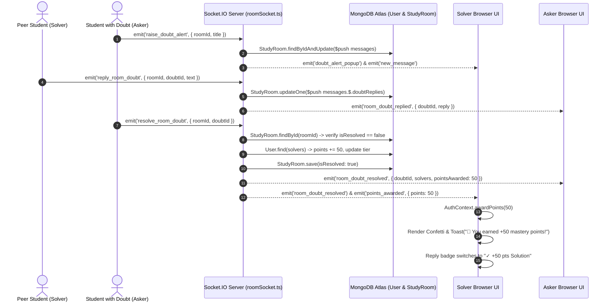

# StudySphere — Architecture & Interaction Map

**Author:** Senior QA Automation Engineer & Test Architect  
**Scope:** Complete End-to-End System Flow Traceability  
**Target Architecture:** React 19 Frontend ↔ Express / Socket.IO Backend ↔ MongoDB Atlas Database  

---

## 1. Flow Breakdown Matrix

| Workflow | Frontend Component(s) | REST Endpoint / Socket Event | Backend Handler | Database Operation | UI State Impact |
| :--- | :--- | :--- | :--- | :--- | :--- |
| **1. User Registration** | `Register.tsx` | `POST /api/auth/register` | `authController.register` | `User.create` with default goals, `points: 0`, `streak: 0` | `AuthContext` stores token and user in `localStorage`; redirects to `/dashboard`. |
| **2. User Login** | `Login.tsx` | `POST /api/auth/login` | `authController.login` | `User.findOne` + `bcrypt.compare` | Generates 7d JWT; populates `AuthContext.user`; navigates to dashboard. |
| **3. Fresh Account State** | `Dashboard.tsx`, `Sidebar.tsx`, `Topbar.tsx` | `GET /api/auth/me` | `authController.getMe` | `User.findById` | Displays Level 1 (0%), 0 points, Novice Scholar, uppercase initials avatar tile (no mock Unsplash photos). |
| **4. Join Study Room** | `StudyRoom.tsx` | Socket: `join_room` | `roomSocket.setupRoomSocket` | `activeUsers.set(socketId, user)` | Updates `liveCount` and renders live peers in `ParticipantList.tsx`. |
| **5. Raise Live Doubt** | `RoomChat.tsx`, `StudyRoom.tsx` | Socket: `raise_doubt_alert` | `roomSocket.setupRoomSocket` | `StudyRoom.findByIdAndUpdate` ($push to `messages`) | Shows floating banner `doubt_alert_popup` and posts doubt card in Room Doubts tab. |
| **6. Reply to Room Doubt**| `RoomChat.tsx` | Socket: `reply_room_doubt` | `roomSocket.setupRoomSocket` | `StudyRoom.updateOne` ($push to `messages.$.doubtReplies`) | Appends threaded answer in room chat; shows `toast.success`. |
| **7. Resolve Room Doubt** | `RoomChat.tsx`, `StudyRoom.tsx` | Socket: `resolve_room_doubt` | `roomSocket.setupRoomSocket` | `StudyRoom.updateOne` + `User.find` + `User.save` (+50 pts & tier check) | Green `Resolved` badge, `✓ +50 pts Solution` badge on replies, +50 pts in `AuthContext`, confetti, and celebratory toast. |
| **8. Publish Global Doubt**| `Doubts.tsx`, `AskDoubtModal.tsx` | `POST /api/doubts` | `doubtController.createDoubt` | `Doubt.create` | Prepends doubt card to list; displays `toast.success('Your doubt has been published...')`. |
| **9. Answer Global Doubt** | `DoubtCard.tsx` | `POST /api/doubts/:id/answers` | `doubtController.addAnswer` | `Doubt.findById` ($push answer, `isResolved: true`) + `User.points += 50` | Optimistic thread append, Accepted banner, +50 pts in `AuthContext`, confetti, and toast. |
| **10. Pomodoro Sync** | `StudyTimer.tsx` | Socket: `timer_action` | `roomSocket.setupRoomSocket` | In-memory broadcast via `socket.to(roomId).emit('timer_sync')` | Circular SVG timer starts/pauses/resets on all connected peer clients; toast on completion. |
| **11. Leaderboard Loading**| `Leaderboard.tsx` | `GET /api/users/leaderboard` | `userController.getLeaderboard` | `User.find().sort({ points: -1 })` | Shimmer skeleton renders during fetch; smoothly transitions to Gold/Silver/Bronze podium & rankings table. |
| **12. Profile Update** | `Profile.tsx` | `PATCH /api/users/profile` | `userController.updateProfile` | `User.findByIdAndUpdate` | Local update in `AuthContext`; reflects in Sidebar and Topbar; shows `toast.success`. |
| **13. Room Invite Copy** | `StudyRoom.tsx`, `ParticipantList.tsx` | `navigator.clipboard.writeText` | Client Browser API | None | Copies current URL; displays non-blocking `toast.success('Room invite link copied...')`. |

---

## 2. In-Depth State & Data Flow Diagrams

### 2.1 In-Room Doubt Resolution & Mastery Points Pipeline

---

## 3. Authoritative Source Analysis (Frontend vs. Backend)

| Domain | Intended Authority | Actual Source of Truth | Drift Risk |
| :--- | :--- | :--- | :--- |
| **Mastery Points Balance** | **Backend (MongoDB Atlas `User.points`)** | Backend is authoritative on fetch/login; Frontend manages optimistic cache via `AuthContext.awardPoints` and `localStorage.getItem('studysphere_user')`. | **Medium:** If a browser localStorage is manually tampered with, refreshing the browser re-synchronizes from `/api/auth/me`. However, if server rejects an award, frontend must reconcile cache. |
| **Doubt Solved Status** | **Backend (`StudyRoom.messages.$.isResolved` and `Doubt.isResolved`)** | Backend MongoDB Atlas document flag. | **Low:** Persisted in database document and broadcasted to all room peers. |
| **Room Presence Count** | **Backend Memory (`roomSocket.activeUsers`)** | Backend `activeUsers` Map indexed by socket ID. | **Low:** Filtered strictly by `roomId` and updated on `connection` and `disconnect` events. |
| **Pomodoro Time Remaining** | **Hybrid / Synchronized** | Synchronized through peer-emitted `timer_sync` events. | **Medium:** Countdown runs on client `setInterval`. If tabs background, local client timers can drift slightly until next sync event. |
